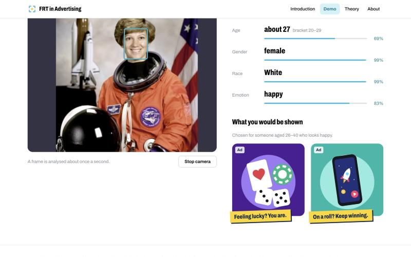

# FRT in Advertising

A working demonstration of facial categorisation in advertising. Point a webcam at your face; a model guesses your age, gender, race and emotion, and the page shows the ads an advertiser would pick for that guess.



It was built as a teaching tool and a small user study for the seminar "Making People Understand Facial Recognition Technologies: Building an AI Application as Didactic Tool" at the Technical University of Munich (winter semester 2022/23), and rebuilt in 2026. It is a non-commercial showcase. The original version is preserved on the [`deprecated-v1`](../../tree/deprecated-v1) branch.

## The study and the papers

- **[The 2022 paper](frontend/public/paper/facial-classification-technologies-in-advertising-2022.pdf)** (PDF, 10 pages): *Facial Classification Technologies in Advertising*, by the seven members of the original group. It covers where the technology is used, a commercial product the demo imitates, the ethical objections, and a study with 51 participants. Most of them rejected facial classification for personalised advertising and hiring, and their views did not change significantly while using the site.
- **[The 2026 update](docs/paper/2026-update.md)**: what the rebuild changed, what was measured, and which of the paper's statements still hold. The rebuild runs no questionnaire and stores nothing, so there is no new user study; the findings about attitudes are those of 2022.

The site's About page presents both and lists every source.

## How it works

```
browser ── one frame (JPEG, 640 px wide) ──▶ API
                                             1. YuNet finds the faces
                                             2. FairFace reads age, gender and race off the largest
                                             3. HSEmotion reads its emotion
                                             4. two ads are drawn from the set for that age,
                                                favouring ones pitched at the mood it read
browser ◀── JSON: boxes, attributes, ads ─── API
```

- **`frontend/`** is a static single-page site: TypeScript, React, Mantine, Vite. About once a second it sends a frame for full analysis; about eight times a second it sends a smaller one just to find the face, so the box follows a moving face.
- **`backend/`** is a stateless Python API: FastAPI and ONNX Runtime. Three models; a full analysis takes about 50 ms on a laptop CPU, finding the face alone about 2 ms.

**Nothing is stored.** A frame lives in the API's memory for the length of one request. It is never written to disk and never logged. There are no accounts, cookies or analytics.

## Run it locally

You need [Docker](https://www.docker.com/) (or [uv](https://docs.astral.sh/uv/)) for the API, and Node 24+ with [pnpm](https://pnpm.io/) for the site.

Start the API on port 8000. The first build downloads the models (116 MB):

```bash
docker compose -f backend/compose.yaml up --build
```

Start the site on port 5173. It proxies `/api` to the API on port 8000:

```bash
cd frontend && pnpm install && pnpm dev
```

Open <http://localhost:5173/demo>.

To run the API without Docker:

```bash
cd backend && uv sync && uv run python scripts/fetch_models.py && uv run uvicorn frt_api.main:app
```

## Tests and checks

| | Command (run in the directory) |
|---|---|
| Backend tests | `uv run pytest` |
| Backend lint, format, types | `uv run ruff check . && uv run ruff format --check . && uv run mypy` |
| Frontend tests | `pnpm test` |
| Frontend lint, format, types | `pnpm lint && pnpm format:check && pnpm typecheck` |
| Frontend production build | `pnpm build` |

Backend tests that need the real models are skipped until `scripts/fetch_models.py` has run. GitHub Actions runs all of the above on every pull request, builds the Docker image, starts it, and has it analyse a test portrait.

## The API

Every route is served both at the root and under `/api` (`/health` and `/api/health`).

`GET /health` returns `{"status": "ok"}`.

`POST /analyze` takes the image itself as the request body (JPEG, PNG or WebP, at most 2 MB and 12 megapixels) with its `Content-Type`.

```bash
curl -X POST -H 'Content-Type: image/jpeg' --data-binary @backend/tests/fixtures/portrait.jpg localhost:8000/analyze
```

```json
{
  "image": { "width": 512, "height": 512 },
  "faces": [
    {
      "box": { "x": 178, "y": 62, "width": 90, "height": 114 },
      "score": 0.93,
      "attributes": {
        "age": { "estimate": 27.1, "bracket": { "min": 20, "max": 29 }, "confidence": 0.71 },
        "gender": { "label": "female", "confidence": 0.99 },
        "race": { "label": "White", "confidence": 0.99 },
        "emotion": { "label": "happiness", "confidence": 0.44 },
        "mood": { "label": "up", "confidence": 0.83 }
      }
    }
  ],
  "ad_set": "26-40",
  "mood": "up",
  "ads": [
    { "id": "wine", "label": "Celebrate. Open the good bottle." },
    { "id": "sweater", "label": "Look as good as you feel." }
  ]
}
```

Faces are sorted largest first and only the largest is analysed.

Ads are targeted in two steps. The estimated age, rounded down, selects one of six ad sets (`ad_set`). The face's mood then decides within that set: ads that have a slogan written for the mood are preferred and shown with it. A neutral face, or a mood reading more likely wrong than right (confidence under 50 %), leaves the top-level `mood` as `null` and the ads are chosen by age alone. Mood never widens the choice beyond the age set.

### Emotion, mood and confidence

The emotion model's single-emotion answers are unreliable, so three things are done to them:

- **Contempt is dropped.** On labelled faces the model answered "contempt" for 5 % of them and was right for none; without it accuracy rose from 53.0 % to 55.6 %.
- **Emotions are pooled into four moods.** Happiness and surprise are `up`, sadness and fear are `low`, anger and disgust are `tense`, and `neutral` stays. The model confuses neighbours far more than groups: it is right about the mood for 66 % of faces, against 56 % for the single emotion.
- **The mood's confidence is calibrated.** The model's own score is a poor guide: it said `up` with an average score of 0.53 and was right 82 % of the time, and said `tense` at 0.67 and was right 53 %. A per-mood logistic fit turns the score into "how often is this reading right", which cut the calibration error on held-out faces from 0.109 to 0.037. A clear smile now reads as 80–95 % happy instead of about 35 %.

The calibration was fitted on 700 FER2013 test faces, which are small greyscale crops; a webcam is a different setting, so treat the percentages as indicative. `attributes.emotion` still carries the single most likely emotion with the model's raw score.

The site adds two things on top: the mood shown is the most common one over the last three frames, and the ads change only when a new ad set or mood is read twice in a row. Errors: 413 too large, 415 wrong type, 422 not a JPEG, PNG or WebP image, or more than 12 megapixels. Interactive documentation is at `/docs` while the API is running.

`POST /detect` takes the same body and returns only where the faces are, largest first:

```json
{
  "image": { "width": 320, "height": 240 },
  "faces": [{ "box": { "x": 111, "y": 39, "width": 56, "height": 71 }, "score": 0.93 }]
}
```

It runs the detector alone, so it is cheap enough to call several times a second.

| Setting | Default | Meaning |
|---|---|---|
| `FRT_CORS_ORIGINS` | `http://localhost:5173` | Comma-separated origins allowed to call the API from a browser. Only matters when the site and the API are on different origins. |
| `FRT_MODELS_DIR` | `models` | Where the three model files are |

## The models, and how they were chosen

Candidates were scored on the same labelled photos: 600 from the FairFace validation set, 600 from UTKFace and 700 from the FER2013 test set. With 600 photos, a gap under about four points is noise.

| Model | Size | Gender (FairFace / UTKFace) | Age bracket, exact / within one | Race, 6 groups |
|---|---|---|---|---|
| **FairFace ResNet-34** (used) | 85 MB | **92.7 % / 93.7 %** | **57.5 % / 96.5 %** | **77.0 %** |
| FastFace teacher | 83 MB | 91.5 % / 98.5 %* | 53.5 % / 94.8 % | none |
| DeepFace (used by v1) | 1.5 GB | 75.7 % / 79.5 % | 35.0 % / 71.8 % | 61.2 % |
| GoogLeNet age and gender (2015) | 48 MB | 78.0 % / 76.5 % | 31.5 % / 70.8 % | none |

\* FastFace was trained on UTKFace, so that figure is inflated.

FairFace natively predicts seven race groups; scored on all seven it is right for 70.2 % of faces. The table merges East and Southeast Asian into one group so that it can be compared with DeepFace, which has six.

For emotion, HSEmotion (EfficientNet-B2) was chosen on its published AffectNet result of 63 % over eight classes; on FER2013 the four candidates scored within a few points of each other (50–57 %). Emotion is the least reliable attribute whichever model is used.

Age comes in nine brackets. The single number shown is the probability-weighted midpoint of the brackets, and it is rounded down before an ad set is chosen. On UTKFace it puts a face on the right side of eighteen 97.5 % of the time.

| File | Purpose | Source | Licence |
|---|---|---|---|
| `face_detection_yunet_2023mar.onnx` | Face detection | [opencv/opencv_zoo](https://github.com/opencv/opencv_zoo) | MIT |
| `fairface.onnx` | Age, gender, race | [yakhyo/fairface-onnx](https://github.com/yakhyo/fairface-onnx), an export of [FairFace](https://github.com/dchen236/FairFace) | Stated as CC BY 4.0 by the exporter; the FairFace authors publish no licence file for the weights |
| `enet_b2_8.onnx` | Emotion | [av-savchenko/face-emotion-recognition](https://github.com/av-savchenko/face-emotion-recognition) | Apache-2.0 code; trained on AffectNet, a research-only dataset |

The models are not in this repository. `backend/scripts/fetch_models.py` downloads them and checks each against a pinned SHA-256. If you plan any commercial use, clear the model licences first.

## Deploying to AWS

Nothing is deployed yet. Both halves are ready for one CloudFront distribution with two origins, told apart by path:

```
browser ── https://your-domain ──▶ CloudFront
                                    ├─ everything else ──▶ S3 bucket (the static site)
                                    └─ /api/*  ──────────▶ API Gateway HTTP API ──▶ Lambda (the container)
```

The site and the API then share one HTTPS origin, so there is no CORS to configure, and browsers offer the camera only to pages served over HTTPS.

### The site

- `pnpm build`, then upload `frontend/dist/` to a private bucket. No build variable is needed: the site calls `/api` on its own origin.
- The site uses clean URLs (`/demo`, `/theory`), so CloudFront must answer unknown paths with `/index.html` and status 200 (a custom error response for 403 and 404, or a viewer-request function).
- Everything under `assets/` has a content hash in its name and can be cached for a year (`Cache-Control: public, max-age=31536000, immutable`). `index.html` must not be cached (`no-cache`).

### The API

- The image runs on Lambda as it is. It carries the [AWS Lambda Web Adapter](https://github.com/awslabs/aws-lambda-web-adapter), which turns each invocation into an ordinary HTTP request to the server inside. Outside Lambda the adapter is never started.
- Lambda pulls images only from ECR. Build for the function's architecture, for example `docker buildx build --platform linux/arm64 backend`.
- Put an API Gateway HTTP API in front, with one route, `ANY /api/{proxy+}`, and throttling. The API is open and unauthenticated; throttling there and a reserved-concurrency limit on the function are the ceiling on spend.
- On the CloudFront `/api/*` behaviour: disable caching, allow `POST`, and forward the `Content-Type` header (the API rejects uploads without it).
- The API answers under `/api` as well as at the root, so nothing between the browser and the function has to rewrite paths.
- Lambda ties CPU to memory. About 2 GB is a starting point, to be measured.
- Expect about nine requests a second from each visitor with the camera on: eight small `/detect` calls and one `/analyze`.

This was checked under AWS's Lambda Runtime Interface Emulator with API Gateway events: `/api/health`, `/api/detect` and `/api/analyze` answer, and a wrong content type is refused. It has not run on Lambda itself, so cold-start time and speed there are unmeasured.

### Elsewhere

The API is also a plain container: port 8000, a `/health` check, about 300 MB of memory idle (under 450 MB with 24 maximum-size uploads in flight), no GPU. Images are decoded and analysed one at a time. It has no rate limiting of its own. If it lives on a different origin from the site, build the site with `VITE_API_URL=https://api.example.com` and set `FRT_CORS_ORIGINS` on the API to the site's origin.

## Credits

This version (2026) is an individual rework by Achraf Labidi.

The original version (2022/23, on the `deprecated-v1` branch) was a group project by Achraf Labidi, Nicole Kubitza, Adrian Pesch, Caner Karaoğlu, Markus Vrancea, Ege Kurt and Po Chieh Lin. The idea, the ad sets and much of the explanatory text come from that work.

The advertisements were drawn for this project and refer to no real brand. The test portrait is NASA's public-domain photograph of astronaut Eileen Collins.

Contact: Achraf Labidi on [LinkedIn](https://www.linkedin.com/in/ashraf-labidi-0xff3e/). More projects: [GravityDarkLab](https://github.com/GravityDarkLab).
